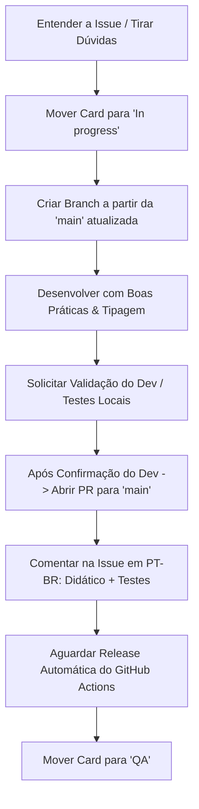

# Diretrizes e Fluxo de Trabalho para Agentes de IA

Este documento define os princípios de engenharia de software, padrões de arquitetura e o fluxo de trabalho obrigatório para agentes de IA que desenvolvem no repositório **Monky**.

---

## 🏛️ Princípios de Engenharia de Software & Arquitetura

Todo código produzido deve seguir as melhores práticas da indústria, com foco em **clareza, robustez, performance e manutenibilidade**, evitando complexidade desnecessária (_sem overengineering_).

### 1. Diretrizes Técnicas por Área do Projeto

#### 🔹 Electron, IPC & Segurança

- **Isolamento Total:** Mantenha `contextIsolation: true` e `nodeIntegration: false`. Nunca exponha módulos inteiros do Node.js ou Electron diretamente no `window` via Preload.
- **Tipagem Estrita de IPC:** Utilize sempre os contratos centralizados em `packages/shared/src/ipc.ts`. Proibido utilizar strings literais soltas ou tipos `any` em chamadas `ipcMain.handle` / `ipcRenderer.invoke`.
- **Prevenção de Memory Leaks no IPC:** Remova listeners e evite registrar handlers IPC repetidamente durante o ciclo de vida da aplicação.
- **Sanitização no Main Process:** Valide todos os payloads recebidos do Renderer antes de executar operações de I/O, rede, arquivos ou navegação externa (`shell.openExternal`).

#### 🔹 WebRTC & Processamento de Áudio/Vídeo

- **Gerenciamento de Ciclo de Vida:** Sempre execute o teardown completo de `RTCPeerConnection` e interrompa trilhas de mídia (`MediaStreamTrack.stop()`) ao encerrar chamadas, desativar câmeras ou mutar microfones.
- **Web Audio API Cleanup:** Feche e desconecte instâncias de `AudioContext`, `MediaStreamAudioSourceNode`, `GainNode` e `AudioWorkletNode` para evitar consumo fantasma de CPU e memória.
- **Resiliência de Rede:** Trate _race conditions_ em trocas de ofertas/respostas SDP e candidatos ICE, garantindo reconexão graciosa em instabilidades de rede.

#### 🔹 Módulos Nativos C++ / Node-API (`@monky/screen-audio`)

- **Memory & Thread Safety:** Garanta a liberação correta de buffers e recursos de áudio do sistema operacional (WASAPI no Windows, CoreAudio no macOS). Nunca trave a thread principal do Node.js — utilize `napi_threadsafe_function` para callbacks assíncronos.
- **Resiliência a Falhas:** Isole erros de captura de áudio com tratamento de exceções robusto para que falhas em dispositivos de som não causem crash no processo Main.

#### 🔹 Renderer Vanilla TypeScript & DOM

- **Limpeza de Event Listeners:** Sempre remova listeners vinculados a `window`, `document`, elementos do DOM ou ao `EventBus` quando uma view, modal ou componente for desmontado/fechado.
- **Gerenciamento de Estado Previsível:** Concentre estados nas Stores dedicadas (`chatStore`, `voiceStore`, `serverStore`, `settingsStore`, `connectionStore`), aplicando mutações claras e sem dependências circulares.
- **Performance de Renderização:** Evite reflows e repaints desnecessários no DOM; prefira mutações cirúrgicas a recriações massivas de HTML.
- **Movimento e Consistência Visual:** Toda superfície controlada pelo Monky deve abrir, fechar, expandir, recolher e transicionar suavemente, reutilizando os helpers e tokens de movimento do renderer. Wizards devem manter uma estrutura estável e deslizar entre etapas, com direção de avançar/voltar. Toda navegação automática por scroll deve usar `utils/scroll.ts`, animar o deslocamento e respeitar `prefers-reduced-motion`; não use `scrollIntoView()` ou atribuição de `scrollTop` diretamente para navegação visível. Restauração exata de estado, sincronização de editores e autoscroll durante drag podem permanecer instantâneos. Preserve foco, teclado, ARIA, cancelamento e `prefers-reduced-motion`; interrompa efeitos obsoletos em vez de acumulá-los. Animações nunca podem atrasar consentimento, revogação de acesso ou liberação de recursos de mídia. Campos e popups devem seguir tema, fonte, ícones e estados do aplicativo, sem controles nativos visualmente destoantes.
- **Feedback de Erro:** Erros acionados por uma operação devem surgir em balões ou toasts compartilhados, com semântica acessível de alerta; nunca deixe uma mensagem de erro solta aparecer dentro do layout. Validação preventiva pode destacar o controle inválido, mas a explicação deve usar a superfície de feedback do aplicativo.
- **Lifecycle de Movimento:** Use `utils/surfaceMotion.ts` para entrada/saída e ownership de popups, `utils/modalSurface.ts` para a pilha de modais, `utils/surfaceVisibility.ts` para expansões reversíveis e `utils/modalSteps.ts` para etapas que substituem o conteúdo do card. Conteúdo revogado deve desaparecer imediatamente. Transições de views devem usar o tipo `view` (somente opacidade), sem transformar ancestrais de menus com posição fixa; atualizações de dados não devem reiniciar a animação da view.
- **Painéis abertos dentro de modais:** Todo painel que o usuário abre abaixo de um controle dentro de um modal deve terminar visível, rolando o modal o mínimo necessário depois da expansão. `setSurfaceVisible` já faz isso quando a abertura vem de uma ação do usuário (`navigator.userActivation`); painéis que aparecem sozinhos, por chegada de dados, nunca rolam a tela. Não abra painéis desse tipo sem passar por `setSurfaceVisible`, nem role manualmente antes da expansão terminar.
- **Controles de Escolha:** Nunca apresente checkbox ou radio button nativos na interface. Use **switch buttons** para opções de liga/desliga e **cards selecionáveis** para escolhas mutuamente exclusivas, como modo de entrada do microfone ou modo de voz do servidor. Reutilize os componentes e estilos existentes, com estado selecionado e operação por teclado acessíveis. O `input type="checkbox"` interno do componente `toggle-switch` é apenas um detalhe de implementação: não pode aparecer como checkbox isolado.

#### 🔹 Backend / Servidor (Clean Architecture Pragmática)

- **Separação de Responsabilidades:** Respeite a divisão entre `domain` (regras puras), `application` (casos de uso) e `infrastructure` (SQLite, WebSocket, rede).
- **Persistência Segura:** No SQLite, utilize transações para operações em lote e prepare queries parametrizadas para evitar corrupção e injeção de dados.
- **WebSocket Resiliente:** Mantenha rotinas de heartbeat (ping/pong) para identificar conexões zumbis e limpar recursos associados.

#### 🔹 Rigor em TypeScript

- **Sem `any`:** Não utilize `any` nem asserções forçadas (`as unknown as Type`). Modele tipos e interfaces no `@monky/shared` sempre que forem compartilhados.
- **Tratamento Seguro de Nulos/Erros:** Trate explicitamente `null`, `undefined` e exceções com blocos `try/catch` e tipos discriminados.

---

### 2. Arquitetura vigente: reutilize antes de criar

O mega code review (#490) dividiu os arquivos gigantes em módulos com uma responsabilidade cada e criou peças compartilhadas para o que se repetia. **Código novo entra nesses módulos.** Não recrie ao lado algo que já existe, nem devolva responsabilidades aos arquivos que foram esvaziados (`WebSocketServer.ts`, `main.ts`, `MainView.ts`, `ChatView.ts`, `ServerCommunityView.ts`).

**Antes de escrever, procure.** Busque pelo conceito, não só pelo nome: "toast", "erro", "modal", "permissão", "rolar até o fim". Se algo equivalente existe, use-o ou estenda-o.

#### Onde cada coisa entra

| Você precisa de | Use |
|---|---|
| **Servidor:** novo tipo de mensagem WebSocket | Rota no `*Handler.ts` do domínio (`apps/server/src/infrastructure/websocket/`, `voice/` para voz), pelo método `routes()` lido pelo `routing/MessageRouter.ts`. Acrescente a linha na tabela fixada de `apps/server/src/test-message-routes.ts`. Nunca um `case` novo no `WebSocketServer.ts`. |
| **Servidor:** decidir se alguém pode ver ou fazer algo | `access/Authorizer.ts`. Mudança que revoga o acesso já entregue passa pelo `access/AccessEpoch.ts`. |
| **Servidor:** enviar um evento | `Outbox.ts`, que escolhe o público: todos, quem tem acesso ao canal ou quem está na chamada. |
| **Servidor:** recurso preso a uma conexão | Liberação idempotente no `releaseConnection()` do `WebSocketServer.ts`, que encerra todos os caminhos (fechamento, kick, troca de aparelho, revogação de bot). |
| **Shared:** payload ou mensagem nova | Tipo em `packages/shared/src/protocolPayloads.ts` e schema zod em `validators.ts`. Recurso novo de protocolo vai como feature em `PROTOCOL_FEATURES` (`protocolCompatibility.ts`), usada só quando os dois lados a anunciam. |
| **Main:** canal IPC | Módulo `apps/client/src/main/ipc/*Ipc.ts` do domínio, registrado pelo `IpcRegistry` (`ipc/registry.ts`) com a política de remetente. O payload é validado com `ipc/guards.ts`, e o contrato fica em `packages/shared/src/ipc.ts`. |
| **Renderer:** modal ou diálogo | `utils/modalShell.ts` (`openModal`): pilha, foco, Tab, Esc e animação. |
| **Renderer:** erro, aviso ou validação | `utils/feedback.ts` (`reportError`, `validateForm`, `markFieldInvalid`). |
| **Renderer:** liga/desliga ou escolha exclusiva | `utils/formControls.ts` (`renderSwitch`, `renderChoiceCards`). |
| **Renderer:** abas de configurações | `views/settings/settingsLayout.ts`. |
| **Renderer:** assistente em etapas | `views/community/wizardShell.ts` (`mountWizard`). |
| **Renderer:** painel redimensionável | `utils/resizableEdge.ts` (`bindResizableEdge`). |
| **Renderer:** view com dados de um servidor | `core/sessionBinding.ts`: a view para quando o servidor, a conexão ou o membro mudam, e as requisições pendentes são canceladas ao fechar. |
| **Renderer:** redesenhar uma lista sem perder foco ou rolagem | `utils/preserveViewState.ts`, com `itemKeys`. |
| **Renderer:** evento interno | `EventBus` tipado. O evento novo entra em `core/appEventMap.ts`. |
| **Renderer:** chat, shell e tela nativa | `views/chat/*` (feed, composer, bandeja, ações), `views/main/*` (cabeçalho, canais, membros, rodapé) e `core/webrtc/nativeScreen/*`. |
| **Texto visível ao usuário** | Chave nos dois locales (`i18n/locales/pt-BR.ts` e `en.ts`; o `en` é tipado, então faltar uma chave quebra o build). Nunca texto fixo no código. |
| **SDK de bots** | `packages/bot-sdk/src/client/*`. Ao mudar um export público, regenere a referência com `node docs-site/scripts/generate-bot-reference.mjs`. |
| **Runtime nativo de tela** | Prazos e observadores com `runtime/asyncTools.cjs` (`within`, `notifyObserver`). |

#### Regras de organização

- **Uma regra, um lugar.** Cálculo, limite, regra de permissão, texto ou markup que aparece em dois lugares vira uma função ou componente só. Cliente, servidor, CLI e SDK compartilham regras pelo `@monky/shared`: a mesma regra de menção, os mesmos limites e as mesmas validações do CLI e do app. Unifique o que é **a mesma regra**, não o que só se parece. Duas coisas que hoje coincidem mas mudam por motivos diferentes continuam separadas.
- **Uma responsabilidade por módulo.** Uma view desenha e delega; estado fica nas stores; rede, IPC e regras ficam em controladores ou serviços. Quando um arquivo passa de umas 800 linhas ou mistura desenho, estado, rede e eventos, divida-o antes de acrescentar mais. A divisão de `ChatView` em `views/chat/*` é o modelo.
- **Quem cria, libera.** Listeners usam `AbortController`/`signal`; `destroy()`/`dispose()` é idempotente; timers, observers e requisições pendentes são cancelados no teardown. Uma segunda montagem não pode duplicar handlers.
- **Corrija a causa, em todos os caminhos.** Um defeito costuma ter irmãos: canal e DM, P2P e SFU, Windows e macOS, teclado e mouse, cliente e Light. Procure o mesmo padrão nos caminhos equivalentes e corrija todos juntos.
- **Sem código morto.** Apague o que deixou de ser usado, em vez de comentar ou manter "por garantia". O histórico do git guarda o antigo.
- **Dado externo nunca vira HTML cru.** Texto, cor, URL ou id vindos do servidor, de outro usuário ou de um bot entram no DOM por `html`/`escapeHtml` (`utils/html.ts`) ou por `textContent`. Nunca por concatenação em `innerHTML`. Isso vale também para atributos como `style`, `src` e `data-*`.
- **Resposta atrasada não vale.** Todo resultado assíncrono (resposta do servidor, IPC, `load` de mídia, timer) confere, antes de agir, se ainda pertence ao pedido atual: mesmo servidor, conexão, sala, sessão ou mensagem. Use `sessionBinding`, `AccessEpoch`, `AbortSignal` ou um id do pedido. Admissões de voz cruzadas, moves seguidos e kick durante a entrada vieram de respostas aplicadas fora de hora.
- **Evento só para quem tem acesso.** No servidor, quem recebe cada envio é decidido no `Outbox.ts`: `broadcastToChannel` para membros com acesso ao canal e `sendToCall` para quem está na chamada. O `access/ChannelVisibility.ts` cuida de quais canais cada conexão conhece. Não mande evento de canal, sala ou recurso privado pelo `broadcast` geral. Quem não tem acesso não recebe nem o evento, nem a contagem, nem o nome de quem entrou ou saiu.
- **Gravar sem perder o anterior.** Arquivo do app se grava com `writeFileAtomicSync` (`apps/client/src/main/atomicFile.ts`) ou pelo mesmo padrão temporário + rename. Substituir algo (avatar, ícone, backup) só apaga o antigo depois de o novo estar gravado. Lotes no SQLite vão numa transação.
- **Custo que não cresce com o servidor.** No servidor, nada de consulta ao banco dentro de laço por membro, mensagem ou canal: carregue em lote e indexe em memória. No renderer, atualize só o item que mudou, em vez de redesenhar a lista.
- **Teste não depende do relógio.** Controle o tempo com `mock.timers` do `node:test` ou com o relógio injetado do módulo. Nunca espere tempo real com `sleep`. Em smoke DOM, encurte os prazos pelas constantes estáticas da classe. Simular `Date.now` derruba o heartbeat de 12 s do `NetworkClient`.
- **Bug corrigido exige teste de regressão que falha sem a correção.** Confira revertendo a correção. Use o nível certo: unitário para regra pura, teste do servidor para protocolo, smoke DOM para interface e teclado. Arquivo de teste novo do servidor só roda no CI se entrar em `test:bots`, `test:community` ou na lista explícita do `.github/workflows/ci.yml`.
- **Revise o próprio diff antes de pedir validação:** duplicação, vazamentos, `any`, código morto, texto fora do i18n e documentação que ficou desatualizada.

---

### 3. Pragmatismo & Anti-Overengineering

- **KISS (Keep It Simple, Stupid):** Prefira sempre a solução mais simples e legível que resolva o problema com eficácia.
- **YAGNI (You Aren't Gonna Need It):** Não crie abstrações prematuras, camadas intermediárias vazias, fábricas ou padrões complexos para funcionalidades que não existem no escopo atual.
- **Legibilidade em Primeiro Lugar:** Código limpo é autoexplicativo, bem nomeado e com comentários focados no _porquê_ das decisões não óbvias.

---

## 👨‍🏫 Didática & Comunicação com o Desenvolvedor

A comunicação do agente deve ser sempre **clara, didática, transparente e respeitosa**:

1. **Explique o Raciocínio:** Não se limite a entregar código pronto. Explique de forma didática o que causava o problema anterior e por que a solução adotada é a ideal.
2. **Ensine o Conceito:** Ao corrigir bugs ou aplicar refatorações complexas (ex.: memory leaks, gerenciamento de eventos, concorrência WebRTC), contextualize a causa raiz e a boa prática envolvida.
3. **Transparência em Decisões:** Caso precise escolher entre diferentes abordagens, exponha brevemente os trade-offs (prós e contras) para o desenvolvedor.

---

## 🔍 Rigor ao Afirmar e ao Documentar

- **Verifique antes de afirmar.** Nunca diga que algo está feito, verde ou mergeado sem ter conferido. O estado de um PR muda enquanto você trabalha: consulte `state` junto de `mergeable`, porque `mergeable: UNKNOWN` tanto significa "o GitHub ainda está calculando" quanto "o PR já foi fechado".
- **Documentação apodrece em silêncio.** Link, âncora, caminho de menu e nome de arquivo não dão erro quando ficam errados — apenas passam a apontar para o lugar errado. Ao mexer em documentação, confira o que citou: âncoras contra o render real, caminhos de menu contra a interface, nomes de arquivo e comandos contra o que existe de fato.

---

## 🧪 Desenvolvimento ao lado da versão instalada

- **Nunca feche a versão instalada para testar uma alteração.** O cliente não empacotado usa automaticamente um perfil próprio por checkout/worktree, em `appData/Monky-development/<identificador>`, separado da identidade, configurações, cache e servidores da instalação. O título da janela é `Monky Dev`.
- **Mantenha o lock de instância única.** Ele continua valendo por perfil; não remova `requestSingleInstanceLock()` nem mate processos pelo nome. Encerre apenas os PIDs que o próprio teste iniciou.
- **Duas instâncias de desenvolvimento precisam de perfis diferentes.** Para QA descartável, passe um `--user-data-dir` próprio para cada participante. Nunca aponte esse parâmetro para o perfil da instalação:

```powershell
npm run build
npm run start --workspace=apps/client -- --user-data-dir="C:\Projetos\Monky-qa\participante-a"
npm run start --workspace=apps/client -- --user-data-dir="C:\Projetos\Monky-qa\participante-b"
```

- O cliente de desenvolvimento mantém também o cache Chromium e o `MONKY_HOME` dos processos filhos dentro do perfil selecionado. Um **CLI de servidor iniciado separadamente** precisa do seu próprio `MONKY_HOME` e diretório de dados; não reutilize registros, bancos, portas ou credenciais de produção.
- Cliente, servidor e bots de QA devem usar versões compatíveis do protocolo. Crie um servidor descartável da mesma branch e valide voz com dois participantes; não use um servidor real para contornar incompatibilidade de versões.

---

## ✅ Validação local obrigatória antes de abrir PR

- **Nunca abra um PR sem executar antes as validações locais correspondentes ao CI, proporcionais à mudança.** Leia `.github/workflows/ci.yml`, os scripts chamados pelos jobs e os testes dos arquivos alterados; não use o CI como primeira rodada de testes.
- `npm run ci:local` executa os passos do `ci.yml` aplicáveis à máquina, continua após falhas e lista todas no fim com o log de cada uma; passos exclusivos de runner descartável aparecem como `PULADO (só CI)`. A execução completa leva dezenas de minutos: rode-a só quando necessário, em mudanças amplas, de protocolo, de contratos compartilhados, de build ou do próprio CI, e complete com o que ele não cobre (por exemplo, macOS e `--package`). Nas demais mudanças, rode só os passos que cobrem os arquivos alterados (`--only <regex>`). Mudança só de documentação não exige a suíte: basta `npm run ci:local -- --only docs`.
- Rode o build e as suítes afetadas sobre a revisão que será enviada. Mudanças em contratos compartilhados, protocolo ou compatibilidade exigem conferir **shared, servidor, cliente e SDK**, inclusive testes com versões fixadas, negociação e fallback. Para alterações de interface, rode também os testes DOM e de teclado/pointer relevantes; somente type-check ou inspeção visual não substituem esses testes.
- **Falha local bloqueia a abertura do PR.** Corrija a causa, acrescente a regressão aplicável e repita os testes antes de publicar. A mesma regra vale para enviar correções a um PR já aberto.
- Verifique diferenças de Windows/macOS e caminhos de falha, como downloads interrompidos, quando a alteração os afetar. Registre no PR os comandos executados e os cenários que dependem de outro sistema operacional; testes locais reduzem falhas evitáveis, mas não garantem disponibilidade de serviços externos nem substituem o CI multiplataforma.
- Preserve a máquina do desenvolvedor: use perfis e servidores descartáveis. Variantes reservadas a runners descartáveis, como testes do clipboard real, continuam exclusivas do CI; nunca altere `GITHUB_ACTIONS` para contornar essa proteção.

---

## 🚢 Publicação de Releases: Somente por Merge de PR

- **Inclua o changelog do aplicativo no mesmo PR.** Mudanças de aplicação/dependências exigem um arquivo novo `release-notes/*.json` com `group`, `pt-BR` e `en`, conforme o `CONTRIBUTING.md`. O changelog técnico dos commits não substitui essas notas. Rode `node scripts/test-changelog.js` e, após os commits, `node scripts/check-client-release-notes.js --base origin/main --head HEAD --merge-base`; CI e release bloqueiam a ausência de notas.
- **NUNCA publique releases a partir de branches de trabalho ou de integração.** Aprovar um teste local ou pedir uma release não autoriza publicar diretamente da branch.
- **Novas versões devem sair exclusivamente do merge de um PR na `main`**, pelo workflow automático de release. Não use `workflow_dispatch`, `gh release create`, tags manuais ou upload de artefatos para contornar esse fluxo, mesmo que o CI da branch esteja aprovado.
- O código publicado deve estar integrado à `main`. Não deixe a implementação apenas em uma branch com um PR aberto depois de anunciar a release.
- PRs empilhados devem ser integrados na ordem correta. Antes de mergear o PR seguinte, ajuste sua base para `main`; nunca faça merge do lote na branch de outro colaborador.
- Quando vários PRs compõem a mesma entrega, coordene os merges para publicar o conjunto completo uma única vez, sem uma versão intermediária que perca funcionalidades já publicadas.
- Merge exige autorização explícita do desenvolvedor e as verificações aplicáveis aprovadas. Não confunda aprovação local, autorização de merge e aprovação formal de review.
- Não promova beta para stable sem pedido explícito. Uma promoção também deve ter como origem código já integrado por PR na `main`, nunca uma beta publicada de uma branch de trabalho.

---

## 🔄 Fluxo de Trabalho a partir do Board

> ⚠️ **Esta seção só se aplica a quem tem acesso ao board da organização.**
> O board é privado. Se você está contribuindo de fora, ele não é visível nem necessário — siga o [`CONTRIBUTING.md`](CONTRIBUTING.md) e ignore tudo o que vem abaixo.

O board oficial fica em: https://github.com/orgs/MonkyOrg/projects/1

**Nem toda issue está no board.** A entrada é filtrada por label, e bug nasce em Discussions — só vira issue depois de confirmado. Se a issue em que você vai trabalhar não tem card, **não crie um**: pergunte ao desenvolvedor.

Quando houver card, siga rigorosamente as etapas abaixo:



### Etapas Detalhadas:

1. **Antes de começar a codar**: mova o card para **In progress**.
   - ⛔ **Nunca desenvolva cards na coluna `Blocked`.** Se um card estiver bloqueado, solicite que o desenvolvedor responsável o mova para fora de `Blocked` (ex.: `Backlog` ou `In progress`). Nunca altere o status de um item bloqueado sem autorização explícita.
2. **Entenda a issue por completo antes de codar.** Se houver requisitos ambíguos, escopo indefinido ou critérios de aceite vagos, **tire dúvidas com o desenvolvedor** antes de prosseguir. Nunca assuma nada — pergunte e só inicie a implementação após os esclarecimentos.
3. **Crie a branch a partir da `main` atualizada.**
   - Sempre execute `git checkout main && git pull` antes de `git checkout -b <branch>`.
   - Nunca ramifique a partir de uma branch com PR aberto sem combinar previamente o empilhamento (_stacked PRs_) com o desenvolvedor.
4. **Desenvolva a solução completa**, respeitando os princípios de arquitetura e qualidade de código.
5. **Solicitar Confirmação e Validação do Desenvolvedor (Ponto de Parada Obrigatório):**
   - ⛔ **Nunca suba código nem abra PR imediatamente após concluir a edição.**
   - Ao finalizar os ajustes, apresente o que foi implementado, os arquivos modificados e oriente o desenvolvedor a realizar os testes locais.
   - Envie a solicitação de confirmação:
     > _"Os ajustes foram implementados com sucesso. Por favor, realize os testes locais e, se estiver tudo certo, me dê o comando para continuar o fluxo de publicação."_
   - **Aguarde a aprovação/comando explícito do desenvolvedor** antes de prosseguir para as próximas etapas (Push / PR / Merge).
6. **Após a Confirmação: Abra um Pull Request para a branch padrão (`main`).**
   - O branch `main` é protegido; todo merge deve passar por PR com squash e deleção da branch de trabalho.
7. **Comente na Issue/Card do board (em PT-BR)** com explicação didática e passo a passo de validação:
   - **O que foi implementado & Por quê (Explicação Didática):** Resumo claro da solução, motivação técnica e arquivos/módulos alterados.
   - **Como testar (Guia para QA/Dev):** Passo a passo reprodutível, cenários principais, casos de borda e resultados esperados.
8. **Após o merge, aguarde a release ser gerada.**
   - Siga a regra de **Publicação de Releases: Somente por Merge de PR** acima. Não substitua o merge por uma publicação manual da branch.
   - O push na `main` dispara automaticamente o workflow **Release** (GitHub Actions), que gera a versão SemVer (`v<MAJOR>.<MINOR>.<PATCH>`) baseada na convenção de commits:
     - **Patch** (`1.0.X`): Correções de bugs (`fix:`, `fix(...)`, `bugfix:`).
     - **Minor** (`1.X.0`): Novas funcionalidades (`feat:`, `feat(...)`, `feature:`).
     - **Major** (`X.0.0`): Breaking changes / refatorações arquiteturais (`BREAKING CHANGE:`, `feat!:`, `major:`).
   - **Só gera versão o PR que muda o que chega ao usuário:** arquivo de aplicação ou de dependência (os mesmos que exigem nota de release) ou uma nota nova em `release-notes/`. PR só de CI, scripts, testes ou documentação não publica release nem conta no número da próxima, então não há release a esperar. Mudança de build ou de CI que precisa chegar ao usuário entra com uma nota de release, que é o que gera a versão.
   - ⚠️ **Toda mudança de compatibilidade entre cliente e servidor é `major`.** Cliente e servidor negociam a compatibilidade ao conectar (`packages/shared/src/protocolCompatibility.ts`): o servidor aceita clientes a partir de `MIN_CLIENT_PROTOCOL` e bots a partir de `MIN_BOT_PROTOCOL`, e cada lado só usa os recursos que os dois anunciaram (`PROTOCOL_FEATURES`). Quem não atualizar continua entrando, mas sem os recursos novos. Quando uma correção de segurança ou uma mudança incompatível eleva um piso, quem ficar abaixo dele deixa de conseguir entrar. Ao mexer em `PROTOCOL_VERSION` (`packages/shared/src/constants.ts`), nos pisos, no formato das mensagens do WebSocket ou no schema esperado pelo outro lado, use `feat!:`/`major:` no título do PR ou um parágrafo `BREAKING CHANGE:` na mensagem de um commit. O CI (`scripts/check-protocol-bump.js`) reprova o PR que mudar o `PROTOCOL_VERSION` sem esse marcador.
   - A versão é calculada a partir da **última release publicada, betas inclusive**, avaliando apenas os commits feitos desde ela. Cada push move o número conforme o que carrega: `fix:` sobe patch, `feat:` sobe minor e breaking change sobe major, mesmo no meio de uma linha de beta (#378). Promover uma beta publica exatamente os números dela (`v3.4.2-beta` → `v3.4.2`).
   - **Cada commit que gera versão vale um salto, não cada release.** Um PR com três `fix:` leva `1.0.0` a `1.0.3`; com duas `feat:` e três `fix:`, a `1.2.3` (#465). Os saltos são aplicados na ordem cronológica dos commits, então a ordem importa: uma `feat:` depois de um `fix:` zera o patch recém-somado. Isso funciona sob squash porque o GitHub deixa a lista dos commits originais no corpo da mensagem — **se você reescrever esse corpo e apagar a lista, o PR volta a valer um salto só**, o do título.
   - Betas saem como `v<MAJOR>.<MINOR>.<PATCH>-beta`, sem contador (`v3.1.2-beta`). O sufixo já carregou um número de 3 dígitos (`-beta001`) para manter em ordem as betas de uma **mesma base** na página de releases do GitHub, que ordena pelo nome da tag (#338); como a base passou a subir a cada release (#378), não existem mais duas betas da mesma base para desempatar e o contador nunca saía de `001` (#382). As tags já publicadas (`-betaNNN` e o legado `-beta.N`) continuam sendo lidas normalmente.
   - ⚠️ **Só mova o card para `QA` após a release ser publicada com sucesso**, pois a validação do QA ocorre sobre o build compilado. Se o PR não gera versão, mova o card para `QA` logo após o merge.
9. **Não mova para Done automaticamente.** O card deve permanecer em `QA` até a validação do responsável, que solicitará a movimentação para **Done** ou o fará manualmente.

---

## 📝 Modelo de Comentário Obrigatório na Issue

Utilize o comando:

```bash
gh issue comment <NÚMERO_DA_ISSUE> --body "<comentário em PT-BR>"
```

### Estrutura do Comentário:

```markdown
### 💡 Como foi implementado & Decisões Técnicas

- **Resumo Didático:** [Explicação clara do que foi resolvido e do conceito aplicado]
- **Arquivos & Camadas Alteradas:**
  - `apps/client/src/...`: [Mudanças realizadas e motivo]
  - `packages/shared/src/...`: [Tipos/contratos ajustados]
- **Boas Práticas Aplicadas:** [Ex.: remoção de event listeners para evitar memory leaks, tipagem estrita de IPC, isolamento de camadas]

---

### 🧪 Como testar (Guia de Validação para QA)

1. **Pré-requisitos:** [Ex.: Iniciar servidor local / conectar 2 clientes]
2. **Cenário Principal:**
   - Passo 1: [Ação]
   - Passo 2: [Ação]
   - **Resultado Esperado:** [Comportamento correto do app]
3. **Casos de Borda & Resiliência:**
   - [Ex.: Testar desconexão de rede, fechar modal repetidamente, mutar/desmutar rápido]
   - **Resultado Esperado:** [Ausência de erros no console ou travamentos]
```

---

## 🛠️ Referência do Board & Comandos Úteis

- **Project ID:** `PVT_kwDOEws3wM4BhD7I`
- **Campo Status (Field ID):** `PVTSSF_lADOEws3wM4BhD7IzhgBIGI`
- **Opções de Status (`single-select-option-id`):**
  - Discussing: `146d7ce6`
  - Backlog: `f75ad846`
  - Blocked: `7a1e61fe`
  - In progress: `47fc9ee4`
  - Awaiting PR Review: `1187975c`
  - After QA Review: `98330754`
  - QA: `df73e18b`
  - Done: `98236657`
  - Ideias descartadas: `6eeb0bfb`

⚠️ **Tabela é cópia, e cópia envelhece.** O board muda sem avisar: a coluna `Ready` ficou documentada aqui depois de já ter sido removida, e a `Awaiting PR Review` existia no board sem constar desta lista. Confira na API antes de confiar:

```bash
gh api graphql -f query='
{ organization(login: "MonkyOrg") { projectV2(number: 1) {
    field(name: "Status") { ... on ProjectV2SingleSelectField { options { id name } } } } } }'
```

### Mover Card no Board:

```bash
gh project item-edit \
  --id <ITEM_ID> \
  --project-id PVT_kwDOEws3wM4BhD7I \
  --field-id PVTSSF_lADOEws3wM4BhD7IzhgBIGI \
  --single-select-option-id <OPTION_ID>
```

_(Para obter o `<ITEM_ID>`, liste os itens com: `gh project item-list 1 --owner MonkyOrg --format json`)_

### Fluxo Git & Pull Request:

```bash
export GIT_SSH_COMMAND='ssh -o BatchMode=yes'
git checkout main && git pull
git checkout -b <nome-da-branch>

# ... desenvolvimento e commits semânticos ...

git push -u origin <nome-da-branch>
gh pr create --title "<tipo>: <descrição>" --body "<descrição didática das alterações>"
gh pr merge <nome-da-branch> --squash --delete-branch
git checkout main && git pull
```

### Trailer Obrigatório de Co-autoria nos Commits:

```text
Co-authored-by: Copilot <223556219+Copilot@users.noreply.github.com>
```
